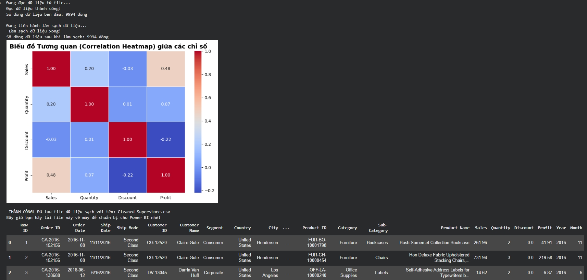

Phân tích Hiệu quả Kinh doanh Cửa hàng Bán lẻ (Superstore Sales Analysis)

📌 Tổng quan dự án (Project Overview)

Trong ngành bán lẻ, việc tối ưu hóa chuỗi cung ứng và chiến lược giá là yếu tố sống còn. Dự án này tập trung phân tích bộ dữ liệu Superstore Sales (hơn 9.000 giao dịch) để giải quyết các bài toán kinh doanh thực tế: nhận diện các mặt hàng gây thua lỗ, tối ưu hóa phân khúc khách hàng và xác định xu hướng tăng trưởng theo mùa vụ.

Dự án áp dụng quy trình End-to-End Data Pipeline: từ việc dùng Python để xử lý dữ liệu thô (ETL) đến việc xây dựng hệ thống báo cáo tương tác (Dashboard) trên Power BI, giúp nhà quản lý có cái nhìn đa chiều về sức khỏe tài chính của doanh nghiệp.

📊 Dữ liệu sử dụng (Dataset)

Nguồn: Superstore Dataset (Kaggle).

Quy mô: Bao gồm dữ liệu bán hàng của nhiều năm trên toàn khu vực.

Đặc trưng chính (Features):

Thông tin đơn hàng: Order Date, Ship Mode, Customer Segment.

Phân loại sản phẩm: Category, Sub-Category, Product Name.

Chỉ số tài chính: Sales (Doanh thu), Quantity (Số lượng), Discount (Giảm giá), Profit (Lợi nhuận).

🛠️ Công nghệ & Kỹ thuật sử dụng (Tech Stack)

Ngôn ngữ: Python (Google Colab) để tiền xử lý.

Thư viện xử lý: pandas (Xử lý missing values, chuẩn hóa kiểu dữ liệu Datetime, trích xuất Year/Month).

Công cụ BI: Power BI Desktop để xây dựng Data Model và Dashboard.

Ngôn ngữ phân tích: DAX (Data Analysis Expressions) được sử dụng để tạo các Measures nâng cao như:

Profit Margin (%) = Tổng lợi nhuận / Tổng doanh thu.

Sales Growth = So sánh doanh thu giữa các kỳ.

💡 Phân tích Chuyên sâu & Chẩn đoán (Key Insights)

Thông qua quá trình trực quan hóa, dự án đã phát hiện ra những "điểm mù" trong kinh doanh mà số liệu thô không thể hiện rõ:

Nghịch lý Doanh thu - Lợi nhuận: * Các mặt hàng như Tables (Bàn) và Bookcases (Tủ sách) đóng góp doanh thu rất lớn nhưng lợi nhuận thực tế lại bị âm (thua lỗ).

Nguyên nhân: Do lạm dụng chiến lược giảm giá (Discount) quá cao (>20%) để kích cầu, dẫn đến việc bán càng nhiều càng lỗ.

Tính mùa vụ (Seasonality):

Doanh thu đạt đỉnh vào Tháng 11 và Tháng 12 hàng năm. Điều này cho thấy nhu cầu mua sắm tăng vọt vào dịp lễ hội cuối năm.

Đề xuất: Cần chuẩn bị nguồn hàng và nhân sự từ Quý 3 để tránh tình trạng đứt gãy chuỗi cung ứng.

Phân khúc khách hàng chủ lực:

Phân khúc Consumer (Khách hàng cá nhân) mang lại hơn 50% tổng lợi nhuận. Đây là nhóm khách hàng trung thành và ít nhạy cảm về giá hơn nhóm Corporate.

🖼️ Hình ảnh Demo (Visualizations)

1. Quá trình xử lý dữ liệu sạch bằng Python

2. Dashboard phân tích doan thu (Power BI)

🚀 Cấu trúc thư mục

Sample - Superstore.csv : Dataset mẫu

Data_Cleaning.ipynb: Mã nguồn Python dùng để làm sạch dữ liệu thô ban đầu.

Cleaned_Superstore.csv: Tập dữ liệu chuẩn sau khi đã được Python xử lý và làm sạch.

Superstore_Dashboard.pbix: File Power BI chứa Dashboard hoàn chỉnh và các hàm tính toán DAX.
