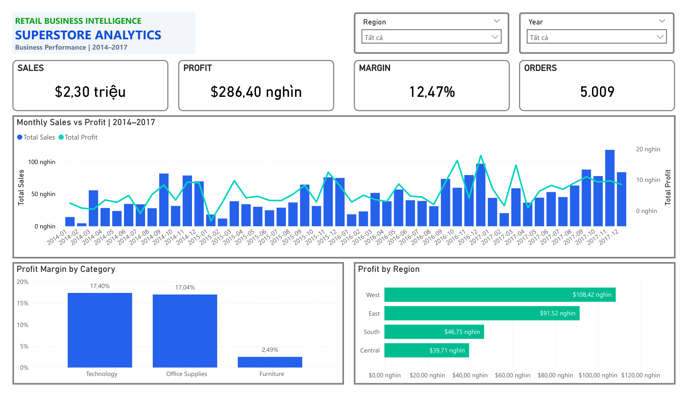
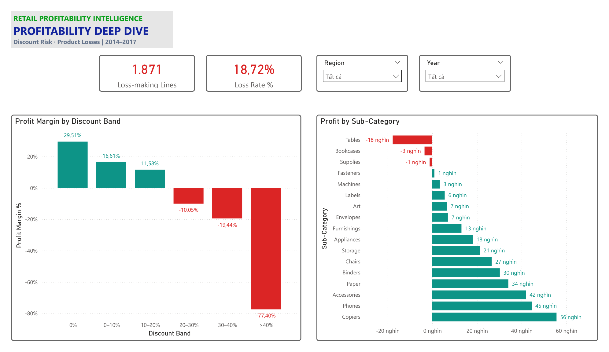

# Superstore Data Analysis | Python & Power BI

**Phân tích hiệu quả kinh doanh bán lẻ qua doanh thu, lợi nhuận và mức giảm giá (2014–2017).**

[](powerbi/Superstore_Dashboard_New.pdf)

Dự án sử dụng **Python/Pandas** để kiểm tra, chuẩn hóa và phân tích dữ liệu; sử dụng **Power BI + DAX** để tạo báo cáo tương tác. Trọng tâm không chỉ là doanh thu, mà là câu hỏi: **Vì sao những nhóm sản phẩm có doanh thu đáng kể vẫn có thể thua lỗ?**

> **File đang dùng:** `data/Sample - Superstore.csv` → `analysis/Superstore_Analysis_Upgrade.ipynb` → `data/Cleaned_Superstore_v2.csv` → `powerbi/Superstore_Dashboard_New.pbix`. Các phiên bản cũ được lưu riêng trong [`archive/`](archive/README.md), **không dùng để tạo dashboard mới**.

> **Dữ liệu mẫu học tập:** Các chỉ số bên dưới là kết quả trên *Sample Superstore*, không đại diện cho báo cáo tài chính của một doanh nghiệp đang hoạt động. Quan sát Discount–Profit là mối liên hệ thống kê, không chứng minh nhân quả.

## 1. Xem dashboard

- [**Báo cáo Power BI — PDF 2 trang**](powerbi/Superstore_Dashboard_New.pdf)
- [**Tệp Power BI — PBIX**](powerbi/Superstore_Dashboard_New.pbix)
- [Business Performance — ảnh](images/business_performance.png)
- [Profitability Deep Dive — ảnh](images/profitability_deep_dive.png)
- [Notebook Python nâng cấp](analysis/Superstore_Analysis_Upgrade.ipynb)

**Business Performance** hiển thị 4 KPI, doanh thu–lợi nhuận theo **48 tháng**, biên lợi nhuận theo danh mục và lợi nhuận theo khu vực.

**Profitability Deep Dive** phân tích tỷ lệ dòng bán hàng bị lỗ, biên lợi nhuận theo mức giảm giá và lợi nhuận của **17 Sub-Category**. Cả hai trang sử dụng bộ lọc `Year` và `Region` đồng bộ.



## 2. KPI toàn kỳ

Kết quả tham chiếu từ **notebook Python nâng cấp chạy trên CSV gốc**, sau đó đối chiếu với các KPI và biểu đồ trên Power BI phiên bản mới. Số tiền trình bày theo USD, làm tròn khi hiển thị, không làm tròn từng dòng trước khi cộng.

| KPI | Kết quả |
|---|---:|
| Dòng bán hàng (*Order Lines*) | **9.994** |
| Đơn hàng duy nhất (`Order ID`) | **5.009** |
| Khách hàng duy nhất (`Customer ID`) | **793** |
| Số lượng sản phẩm (*Quantity*) | **37.873** |
| Doanh thu (*Total Sales*) | **$2.297.200,86** |
| Lợi nhuận (*Total Profit*) | **$286.397,02** |
| Biên lợi nhuận (*Profit Margin*) | **12,47%** |
| Dòng có lợi nhuận âm (*Loss-making Lines*) | **1.871** |
| Tỷ lệ dòng có lợi nhuận âm (*Loss Rate*) | **18,72%** |

**Định nghĩa:** `Profit Margin = SUM(Profit) / SUM(Sales)`; `Loss Rate = số dòng có Profit < 0 / tổng số dòng`. Một dòng dữ liệu là **dòng sản phẩm trong đơn**, không phải một đơn hàng duy nhất.

## 3. Những phát hiện kinh doanh

### 3.1. Doanh thu cao không đảm bảo biên lợi nhuận cao

| Danh mục | Sales (USD) | Profit (USD) | Margin |
|---|---:|---:|---:|
| Technology | 836.154,03 | 145.454,95 | **17,40%** |
| Furniture | 741.999,80 | 18.451,27 | **2,49%** |
| Office Supplies | 719.047,03 | 122.490,80 | **17,04%** |

Furniture đạt doanh thu lớn nhưng khả năng sinh lời thấp. Cần phân tích chi tiết giá bán, cơ cấu sản phẩm và giảm giá trước khi đề xuất thay đổi chính sách.

### 3.2. Nhóm sản phẩm cần rà soát

- **Tables:** khoảng **−$17.725,48** lợi nhuận.
- **Bookcases:** khoảng **−$3.472,56** lợi nhuận.
- **Supplies:** khoảng **−$1.189,10** lợi nhuận.
- **Copiers:** khoảng **+$55,6 nghìn**, thuộc nhóm đóng góp lợi nhuận cao nhất.

### 3.3. Giảm giá lớn đi kèm rủi ro biên lợi nhuận âm

| Discount Band | Profit Margin |
|---|---:|
| 0% | +29,51% |
| (0%, 10%] | +16,61% |
| (10%, 20%] | +11,58% |
| (20%, 30%] | −10,05% |
| (30%, 40%] | −19,44% |
| > 40% | **−77,40%** |

Nhóm `Discount > 40%` có **933 dòng**, tất cả có `Profit < 0` trong dữ liệu, với tổng lợi nhuận âm xấp xỉ **$99,56 nghìn**. Đây là **mối liên hệ**, không phải kết luận giảm giá là nguyên nhân duy nhất gây lỗ.

Xem thêm: [Phân tích kinh doanh và đề xuất bằng tiếng Việt](docs/PHAN_TICH_KINH_DOANH_VI.md).

## 4. Quy trình kỹ thuật


**Công nghệ:** Python, Pandas, NumPy, Matplotlib, Jupyter/Google Colab, Power BI Desktop, Power Query M và DAX.

Notebook mới có kiểm tra dữ liệu thiếu, khóa trùng, ngày giao hàng trước ngày đặt hàng, kiểu số và giá trị bất thường; giữ nguyên phần thập phân của `Sales`/`Profit` trước khi tổng hợp. Các biểu đồ Power BI tự cập nhật theo `Year` và `Region`.

## 5. Cấu trúc repository gọn gàng


Thư mục gốc của repo **chỉ để README và các thư mục chính**; file dữ liệu dùng được gom vào `data/`. Các phiên bản cũ chuyển vào `archive/` để đối chiếu khi cần, tránh người xem mở nhầm.

```text
superstore-data-analysis/
├── README.md
├── data/                                    
│   ├── README.md
│   ├── Sample - Superstore.csv             # CSV gốc
│   └── Cleaned_Superstore_v2.csv          # CSV sạch v2
├── analysis/
│   └── Superstore_Analysis_Upgrade.ipynb  # Notebook Python đang dùng
├── powerbi/
│   ├── Superstore_Dashboard_New.pbix        # Dashboard chính thức
│   └── Superstore_Dashboard_New.pdf         # PDF 2 trang chính thức
├── images/
│   ├── business_performance.png
│   └── profitability_deep_dive.png
├── docs/
│   ├── PHAN_TICH_KINH_DOANH_VI.md
│   ├── GHI_CHU_DU_LIEU_VA_NOTEBOOK.md
│   ├── CONG_THUC_DAX_VA_POWER_BI.md
│   └── KIEM_TRA_PBIX_VI.md
└── archive/                                 # Lưu phiên bản cũ
    ├── README.md
    ├── Cleaned_Superstore.csv
    ├── Data_Cleaning.ipynb
    ├── Superstore_Dashboard.pbix
    ├── Superstore_Dashboard.pdf
    ├── Superstore1.jpeg
    └── Superstore2.jpeg
```


## 6. Cách chạy lại dự án

1. Clone/tải repo, lấy CSV nguồn tại `data/Sample - Superstore.csv`. Mở `analysis/Superstore_Analysis_Upgrade.ipynb`. **Notebook hiện dùng `Path("Sample - Superstore.csv")`**, vì vậy khi chạy trên Colab cần tải CSV vào `/content` (hoặc sửa `INPUT_FILE` thành đường dẫn `data/Sample - Superstore.csv` nếu chạy tại thư mục gốc repo).
2. Chạy toàn bộ cell. Notebook xuất `Cleaned_Superstore_v2.csv` trong thư mục làm việc; chuyển file kết quả vào **`data/Cleaned_Superstore_v2.csv`** khi upload GitHub. Notebook **không** làm tròn từng dòng `Sales`/`Profit`.
3. Mở `powerbi/Superstore_Dashboard_New.pbix` bằng Power BI Desktop. Nếu tệp báo lỗi đường dẫn, vào **Transform data → Source** và trỏ tới `data/Cleaned_Superstore_v2.csv` trên máy. Giữ nguyên tên bảng truy vấn **`Cleaned_Superstore`**.
4. Kiểm tra các KPI trong mục 2; chọn `Year` hoặc `Region` để kiểm tra tương tác. Trả các slicer về **Tất cả** trước khi xuất bản.
5. Đọc [Ghi chú DAX và Power BI](docs/CONG_THUC_DAX_VA_POWER_BI.md) và [Kiểm tra cấu trúc PBIX](docs/KIEM_TRA_PBIX_VI.md).

## 7. Giới hạn phân tích

- `Profit` được diễn giải theo định nghĩa của bộ dữ liệu; không mặc nhiên là **lợi nhuận ròng kế toán**.
- Có thể kiểm tra tương quan giữa `Discount` và `Profit`, nhưng không khẳng định **quan hệ nhân quả** nếu thiếu dữ liệu chi phí, marketing, đối chứng và chính sách giá.
- Tổng cũ từ `archive/Cleaned_Superstore.csv` khác rất nhỏ so với CSV v2 vì notebook ban đầu đã làm tròn **từng dòng**, trước khi cộng: bản cũ Sales **$2.297.200,65**, Profit **$286.396,54**; bản v2 Sales **$2.297.200,86**, Profit **$286.397,02**.
- PBIX mới có chứa **trang cũ ẩn** nhằm đối chiếu và dự phòng; PDF cuối chỉ xuất **2 trang mới**.
- PBIX có thể chứa đường dẫn nguồn CSV tuyệt đối theo máy tác giả; người sử dụng khác cần cập nhật đường dẫn nguồn và không nên công khai thông tin kết nối cá nhân.
- File nguồn thuộc bộ dữ liệu *Sample Superstore*, thường được dùng cho học tập. 
